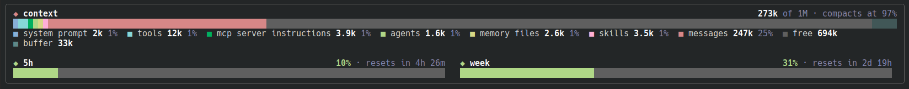

# context-band

A Claude Code mod that draws a band above the prompt: your context window split by category, and your 5-hour and weekly quotas, kept up to date while you work.



## Install

Type this at the prompt of a Claude Code terminal session:

```
/plugin install context-band --marketplace flv12/claude-usage-band
```

Answer `y` to add the marketplace, then pick the **user** scope so the band shows in every project.

## Usage

The band shows at the start of every session. `/band` hides it, and `/band` again shows it, for the current session only.

## What it shows

- **Context**: the window split by category, as `/context` lists it (system prompt, tools, MCP tools, agents, memory files, skills, messages, free space). The auto-compact buffer closes the bar, and the header gives the size used, the window and the compaction threshold. Figures are local estimates, so drawing the band sends no API request.
- **Quotas**: the 5-hour and weekly windows (and a gateway's spend limit, when there is one), with the share used, a bar going green → yellow → red, and the time left before each resets. They are available on a Claude subscription and appear after the first response of the session.
- **Updates**: after each turn, whenever a quota moves, and every 5 seconds. The band is redrawn only when a figure changed. When the band is narrow, the quotas stack.

The band draws in the terminal and in the desktop app's Code tab, and steps aside while a survey is shown. Only one plugin can draw the band above the prompt at a time, so turn off any other mod that uses it.

## Development

Built and tested on Claude Code 2.1.292. Plugin hooks modules are an early-access API.

```sh
claude --plugin-dir .        # run a session with the mod loaded from this folder
claude plugin validate .     # check the manifests and the hooks module
claude plugin test .         # run tests/*.test.tsx
tsc -p .                     # type-check, once Claude Code has loaded the mod and written .claude-plugin/types/
```

Files:

- `hooks/register.tsx`: the hooks module (the band, `/band`, the refresh).
- `types/index.d.ts`: the mod's session state.
- `tests/band.test.tsx`: drawing, bar widths, live refresh, `/band`, surveys.
- `docs/band.png`: the screenshot above.
- `.claude-plugin/plugin.json` and `.claude-plugin/marketplace.json`: the manifest, and the file that lets this repository be installed as a marketplace.
